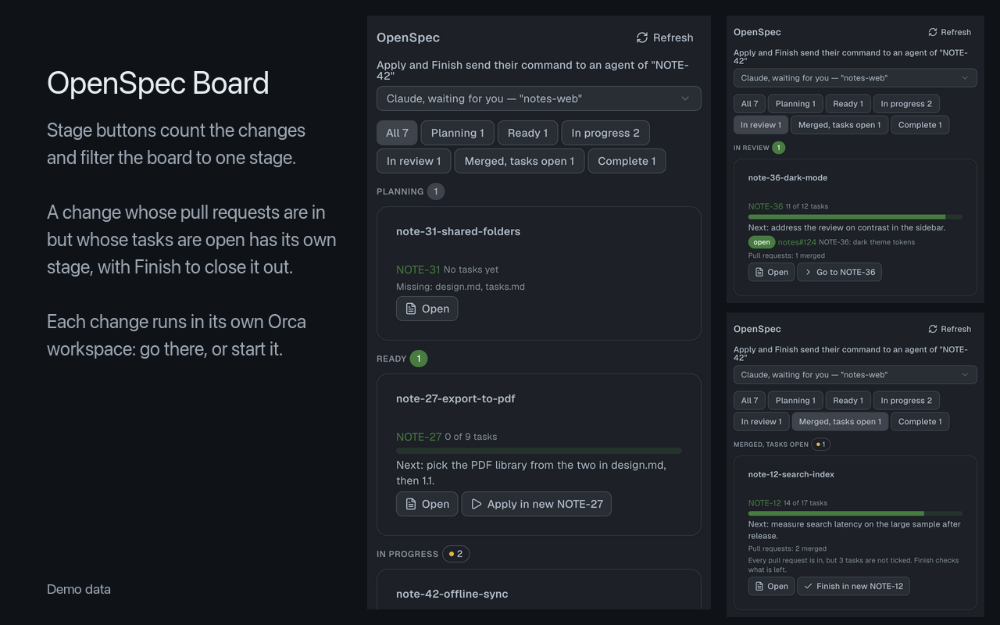

# OpenSpec Board for Orca

A kanban board for [OpenSpec](https://github.com/Fission-AI/OpenSpec) spec-driven
development inside [Orca](https://orca.dev), the app that runs a fleet of AI coding
agents such as Claude Code and Codex. It shows every active OpenSpec change by stage,
with its task progress, the next step, its ticket and its GitHub pull requests, and
sends `/opsx:apply`, a finish check or your own command to the agent working on that
change, in one click.



*The screenshots use made-up demo data.*

## Why

OpenSpec keeps each change in `openspec/changes/` as a proposal, a design and a task
list. With several agents working in parallel it gets hard to see which change is where,
which one stalled after its pull requests were merged, and which agent should take the
next step. The board answers that from the files and from GitHub, without a separate
tracker to keep in sync.

## Features

- **Stages from real signals**: Planning, Ready, In progress, In review, Merged with
  open tasks, Complete, worked out from the artifacts, the ticked tasks in `tasks.md`
  and the change's pull requests.
- **This workspace first**: the change the focused Orca workspace works on is pinned at
  the top.
- **Stage filter**: buttons at the top count the changes in each stage and show one
  stage at a time.
- **Live**: the board redraws when a file under `openspec/changes` changes, an agent
  stops, or you switch workspaces, and rechecks every 30 seconds while it is visible
  (Orca stops an idle worker, and its file watch with it).
- **Next step**: the `Next:` paragraph of `tasks.md`, so you resume where the last
  session stopped.
- **Tickets**: a link to the ticket for each change, from a pattern on the folder name
  (Jira, Linear, GitHub Issues or any tracker with a URL per key).
- **GitHub pull requests**: open, merged and closed pull requests per change, found
  with `gh search prs`.
- **Apply and Finish**: send `/opsx:apply`, a check-then-`/opsx:archive`, or any command
  you configure to a Claude Code, Codex or other agent, only in the change's own Orca
  workspace, or create that workspace with an agent already working.
- **Task list**: each change opens on its `tasks.md` as a checklist, one collapsible
  section per heading with its done count; finished sections start folded.
- **Read the change**: proposal, design and specs rendered in the panel, one click to
  open them in Orca's editor.
- **One config file**: `openspec/board.json` describes how your team runs OpenSpec;
  without it the board behaves like plain OpenSpec.
- **Read-only**: it never writes a file in your repository.

## Install

Requires Orca 1.4.248 or newer. Install it from the Orca CLI, or from this repository's
Git URL in Orca's plugin settings:

```sh
orca plugin install IBazylchuk/orca-plugin-openspec-board
```

Then approve the access it asks for: read the focused workspace, read the agent list, send text to a terminal, and
open workspaces and files in Orca (for "Open in editor" and "Go to"). Without a version
Orca installs the newest `vX.Y.Z` tag.

The worker runs as a trusted Orca worker, with your account's access to the machine.
It only reads files under `openspec/changes`, runs `gh search prs` when you configure
pull requests, runs `orca worktree create` when you press a "… in new" button, and never
writes a file.

## Stages

| Stage | When |
|---|---|
| Planning | A required artifact is missing |
| Ready | Every artifact is there, no task ticked |
| In progress | Some tasks ticked |
| In review | A pull request of the change is open |
| Merged, tasks open | Every pull request is closed and one is merged, but some tasks are not ticked: either work is left or `tasks.md` is behind |
| Complete | Every task ticked and no pull request open |

When pull requests are configured but the search fails before any result was kept, the
card says so and the change is never shown as Complete. A merged pull request alone never
makes a change Complete: the tasks say what the change
promised, and a change whose pull requests are in but whose tasks are open is the one
that silently stalls.

Archived changes are not shown.

## Config

`openspec/board.json`, every key optional:

```json
{
  "requiredArtifacts": ["proposal.md", "design.md", "tasks.md"],
  "resumeLine": "^Next:",
  "ticket": {
    "pattern": "^proj-(\\d+)",
    "key": "PROJ-$1",
    "url": "https://tracker.example.com/browse/{ticket}"
  },
  "pullRequests": { "owner": "example-org", "search": "{ticket} in:title" },
  "apply": "/work {ticket}",
  "finish": "/close {ticket}",
  "agent": "claude",
  "files": { "exclude": ["research"] }
}
```

| Key | Default | Meaning |
|---|---|---|
| `requiredArtifacts` | `proposal.md`, `design.md`, `tasks.md`, `specs` | Files or folders a change needs to leave Planning. `skip_specs: true` in a change's `.openspec.yaml` drops `specs` for that change |
| `resumeLine` | none | A regular expression for the line in `tasks.md` that says what comes next; the card shows the rest of its paragraph |
| `ticket` | none | `pattern` matched against the change folder name, `key` built from its groups, optional `url` with `{ticket}` |
| `pullRequests` | off | `gh search prs --owner <owner>` with `search`, where `{ticket}` becomes up to six tickets joined by `OR`. Only pull requests whose title names the ticket count. Results are kept five minutes, and kept as they were when a search fails. GitHub allows 30 searches a minute per account, shared with your other `gh` use. Needs `gh` signed in |
| `apply` | `/opsx:apply {change}` | What Apply sends; `{change}` and `{ticket}` are replaced |
| `finish` | a check, then `/opsx:archive {change}` | What Finish sends. The default asks the agent to compare `tasks.md` with the code, the Git history and the pull requests, tick what is really done, run `/opsx:archive` when nothing is left, and otherwise list what is left and stop. Set your own to add your release steps, such as moving the ticket to Done |
| `agent` | `claude` | The agent a "… in new" button starts in the new workspace |
| `applyAnywhere` | `false` | `true` lets Apply send any change to an agent of whatever workspace is focused, instead of only from the change's own workspace |
| `files.exclude` | none | Folders inside a change that the file list never walks, such as raw research output |

Problems in the file show at the top of the board, and the default is used for the
broken key. The `complete` key of 0.2 is no longer read and is reported until removed.

## Apply and Finish

| Stage | Buttons |
|---|---|
| Ready, In progress | Apply |
| In review | Apply; Finish too once 80% of the tasks are ticked |
| Merged, tasks open; Complete | Finish |

When Apply and Finish would send the same text, only Apply is shown.

A change runs in its own workspace: the Orca workspace whose name or branch contains
the change's ticket key or its folder name, as a whole word (`PROJ-7`, or a branch
`feature/add-dark-mode`), and that can see the change's folder. The agents of one
workspace work on one change, so the board never sends another change to them.

| Where you are | What the card offers |
|---|---|
| The change's own workspace | Apply or Finish, sent to the agent you pick |
| Another workspace, and the change has its own | Go to that workspace |
| A folder workspace, and the change has none | Apply or Finish in a new workspace named after the change: `orca worktree create` makes a sibling folder workspace and starts `agent` there with the command |
| A Git worktree, and the change has none | A note to create a workspace named after it (a new Git worktree is left to your own setup) |

Apply and Finish type the command and press Enter. They wait while the chosen agent is
busy or asks for your approval, so the command never lands in the middle of a run. A
change or ticket name with a control character is refused, so a hostile folder name
cannot submit a second line.

## Develop

```sh
orca plugin types .
orca plugin test .
orca plugin check .
orca plugin dev watch .
scripts/screenshots.sh
```

`scripts/screenshots.sh` redraws the images in `docs/` from the made-up demo data in
`src/panel.check.ts`. Orca draws them inside its window, so it waits a few seconds for
you to hide Orca (Cmd+H) first.

See [AGENTS.md](AGENTS.md) for the rules of this repository.

## Licence

MIT
